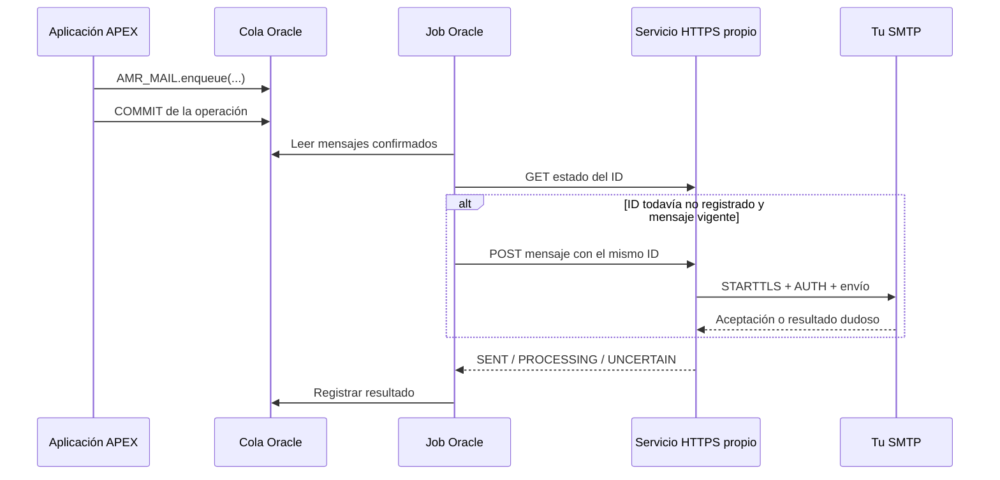

# Oracle APEX SMTP Relay

Envía correos de una aplicación Oracle APEX mediante **tu propio servidor SMTP**,
usando un pequeño servicio HTTPS en un hosting PHP.

La aplicación guarda un mensaje en una cola Oracle. Un job posterior llama al
servicio por HTTPS/443. El hosting entrega el mensaje al SMTP con STARTTLS.
La contraseña SMTP permanece en el hosting; APEX utiliza una clave API distinta,
guardada como **Web Credential**.

El proyecto incluye un servicio PHP independiente y ejemplos Oracle genéricos.
No incluye exports de aplicaciones, información de una instalación real, claves
ni conexión a una base de datos.



## Cuándo sirve

Es una alternativa cuando tu aplicación puede hacer llamadas HTTPS, pero la
conexión SMTP directa está restringida por la plataforma o por la red.

En Autonomous, la documentación de APEX exige un **endpoint privado** para su
configuración SMTP de terceros. Always Free no admite ese tipo de endpoint.
Las notas de red de Autonomous permiten HTTPS por 443 desde un endpoint público,
sujeto a ACL y validación de certificados. Este diseño utiliza esa capacidad.
[SMTP en APEX](https://docs.oracle.com/en/cloud/paas/autonomous-database/serverless/adbsb/apex-send-email.html),
[Always Free](https://docs.oracle.com/en-us/iaas/autonomous-database-serverless/doc/autonomous-always-free.html),
[restricciones de paquetes y red](https://docs.oracle.com/en/cloud/paas/autonomous-database/serverless/adbsb/autonomous-plsql-packages.html).

No cambia el funcionamiento interno de `APEX_MAIL`. Tu aplicación debe llamar a
`AMR_MAIL.enqueue` o adaptar su propia cola al contrato HTTPS.

## Alcance y límites

- Un destinatario y cuerpo de texto UTF-8 por mensaje.
- Remitente y SMTP definidos por el propietario del hosting.
- Autenticación de la API, límites de frecuencia y tamaño, estados persistentes
  e idempotencia por identificador de solicitud.
- Sin adjuntos, HTML, listas masivas, webhooks de rebote ni confirmación de lectura.
- `SENT` significa **aceptado por SMTP**. Verifica entrega en el buzón y spam.
- No se promete exactly-once: un resultado SMTP ambiguo se detiene como
  `UNCERTAIN` y requiere revisión manual.

La solución de origen se verificó con APEX 26.1, Autonomous 26ai y PHP 8.4.
**Los ejemplos Oracle de este repositorio fueron generalizados y requieren
compilación y validación en tu propio esquema.** La suite incluida prueba el servicio PHP con
SMTP simulado; no instala SQL en Oracle ni envía correos reales.

## Requisitos

| Componente | Requisito |
|---|---|
| Hosting | PHP 8.1+; preferir una versión con soporte, como 8.4 |
| Extensiones PHP | PDO SQLite, OpenSSL; Composer 2 para instalar PHPMailer |
| Almacenamiento | Directorio privado escribible por el usuario PHP, fuera del directorio web |
| Web | Certificado HTTPS público válido para el nombre usado por APEX |
| SMTP | Puerto 587 con STARTTLS, certificado válido y credenciales autorizadas |
| APEX | `APEX_WEB_SERVICE`, Web Credentials de tipo HTTP Header |
| Oracle | JSON, identity columns, permisos para tablas/paquetes; `CREATE JOB` para automatizar |
| Desarrollo local | PHP con esas extensiones, Composer y Node.js 20+ para las pruebas |

El servicio necesita salida del hosting hacia el SMTP. No requiere abrir un
servidor SMTP propio ni cambiar MX para usar un buzón existente.

## Archivos

```text
hosting/public/           Única parte accesible por HTTP
hosting/private/          Servicio, configuración y dependencias privadas
deploy/cpanel/            Ejemplo opcional de handler PHP por carpeta
sql/                     Instalación y uso de ejemplo en Oracle
tests/                   Pruebas sin mensajes reales
tools/                   Pruebas y control de contenido publicable
docs/API.md              Contrato HTTPS y estados
docs/TROUBLESHOOTING.md   Diagnóstico y recuperación
```

## 1. Instalar dependencias

Descarga y extrae oracle-apex-smtp-relay-v1.0.0.zip. Trabaja dentro de la carpeta extraída; el ZIP automático de GitHub contiene este paquete como archivo anidado. En una copia local o en un directorio
privado del hosting, ejecuta:

```bash
cd hosting/private
composer install --no-dev --no-interaction --prefer-dist --no-plugins --no-scripts
```

El lockfile fija la versión de PHPMailer. Si el hosting no tiene Composer,
ejecuta la instalación localmente y sube también `vendor/` al directorio privado.
No subas `vendor/` al directorio web. PHPMailer conserva su licencia propia;
consulta [THIRD_PARTY.md](THIRD_PARTY.md).

## 2. Ubicar los archivos en el hosting

Ejemplo para una cuenta Linux cuyo home es `/home/usuario`:

```text
/home/usuario/
├── public_html/
│   └── apex-mail-relay/
│       ├── index.php
│       └── .htaccess
└── apex-mail-relay-private/
    ├── app.php
    ├── Relay.php
    ├── setup.php
    ├── control.php
    ├── config.example.php
    ├── vendor/
    └── state/             Se crea al usar el servicio
```

Copia el **contenido** de `hosting/public/` a `public_html/apex-mail-relay/`
y el contenido de `hosting/private/` a `/home/usuario/apex-mail-relay-private/`.
Incluye los archivos ocultos. No copies el repositorio completo a `public_html`.

El bootstrap público calcula el directorio privado a partir de esa estructura.
Si tu document root es diferente, adapta únicamente esa ruta en `index.php`.
Mantén la configuración y SQLite fuera de cualquier directorio publicado.

```bash
chmod 700 ~/apex-mail-relay-private
```

### Importante: PHP de consola y PHP web pueden diferir

`php -v` no prueba qué versión ejecuta la URL. Un sitio puede heredar PHP 7.4
mediante `.htaccess` aunque Terminal use PHP 8.4.

Si tu servidor usa el handler cPanel compatible, verifica primero que tenga
`ea-php84` y aplica `deploy/cpanel/php84.htaccess.example` **solo en la carpeta
del servicio**. No cambies el PHP de todo tu sitio para probar esta solución.
Con PHP-FPM o PHP Selector, consulta al proveedor; puede hacer falta un subdominio
con una versión propia. El método `.htaccess` no sirve para todos los handlers.
[Guía de cPanel](https://support.cpanel.net/hc/en-us/articles/24112641934103-How-to-set-a-different-PHP-version-per-directory).

## 3. Crear la configuración privada

Ejecuta personalmente desde Terminal del hosting:

```bash
php ~/apex-mail-relay-private/setup.php
```

El asistente solicita:

1. Nombre DNS del servidor SMTP.
2. Remitente autorizado y usuario SMTP.
3. Una clave API nueva generada y guardada en tu gestor de contraseñas:
   64 caracteres aleatorios recomendados, mínimo 32.
4. Contraseña SMTP.

Las entradas de secretos se ocultan. El script genera `config.php` con permisos
0600 y **`enabled=false`**. Guarda la clave API para ingresarla después en APEX.
No uses la contraseña SMTP como clave API ni copies estos valores al chat,
al SQL, a ejemplos, capturas o GitHub.

El script requiere Terminal Linux y `stty`. Si el proveedor bloquea esas funciones,
configura los valores con un mecanismo privado del hosting que no muestre secretos
en comandos, historial o logs. Nunca crees un formulario público de instalación.

Antes de configurar, la URL devuelve `503 not_configured`. Después, sin cabecera
de autenticación, debe responder `401 unauthorized`. **Es el resultado esperado.**

## 4. Crear la Web Credential en APEX

App Builder → Workspace Utilities → Web Credentials → Create:

| Campo | Valor |
|---|---|
| Name | `APEX_MAIL_RELAY` |
| Static ID | `APEX_MAIL_RELAY` |
| Authentication Type | `HTTP Header` |
| Credential Name | `X-APEX-Mail-Key` |
| Credential Secret | La misma clave API usada en setup |
| Valid for URLs | `https://tu-dominio/apex-mail-relay/` |

El secreto se ingresa personalmente desde la pantalla. Usa la URL HTTPS exacta
del servicio y limita su alcance a esa ruta. No lo guardes en una tabla propia.
El ejemplo usa `p_credential_static_id` para recuperarlo de forma protegida.
[API de APEX](https://docs.oracle.com/en/database/oracle/apex/26.1/aeapi/MAKE_REST_REQUEST-Function.html).

## 5. Dar acceso HTTPS en Autonomous

Edita **localmente** `sql/09_https_acl_admin.sql`:

- `host_name`: solo el hostname de la URL, sin `https://` ni ruta.
- `app_schema`: tu esquema de aplicación.

Ejecuta personalmente como **ADMIN de la base en Database Actions**.
El ADMIN del workspace APEX es una identidad distinta y no obtiene esos permisos
por llamarse ADMIN. El script limita acceso HTTP al host indicado por puerto 443
para el esquema y el motor APEX; no concede SMTP ni acceso a todos los hosts.

Fuera de Autonomous, pide al DBA una ACL equivalente para tu versión y entorno.
No agregues comodines o privilegios generales para resolver un error.

## 6. Instalar los ejemplos Oracle

Usa **SQL Workshop → SQL Scripts**, seleccionando tu esquema. No uses **Quick SQL**:
esa herramienta interpreta texto para generar tablas y no ejecuta el paquete
PL/SQL original. No necesitas importar una aplicación APEX.

| Orden | Script | Configuración / resultado |
|---|---|---|
| 1 | `00_prerequisites_readonly.sql` | Revisa contexto, versión y permisos sin modificar datos. |
| 2 | `01_install.sql` | Sustituye `YOUR_APEX_SCHEMA`. Crea AMR_CONFIG, AMR_OUTBOX y AMR_MAIL. Se detiene si existen objetos de esos nombres. |
| 3 | `02_configure.sql` | Sustituye endpoint y workspace. Configura el transporte deshabilitado. |
| 4 | `03_health.sql` | GET autenticado sin enviar mensajes. Debe informar HTTPS y Web Credential OK. |

Detente ante cualquier error. Consulta `USER_ERRORS` o `07_status_readonly.sql`.
La instalación usa DDL y confirma transacciones; ejecútala sin cambios pendientes.
No elimines objetos de una instalación parcial sin revisar primero qué se creó.

Los ejemplos asumen la ruta `/apex-mail-relay/index.php` y HTTPS/443.
Si necesitas otro contrato de URL, adapta y revisa también la validación de endpoint
del paquete; no aceptes URLs que provengan de usuarios de la aplicación.

## 7. Habilitar y enviar un único correo

Una vez que `03_health.sql` terminó correctamente:

```bash
php ~/apex-mail-relay-private/control.php enable
```

Este comando permite envíos autenticados; no envía un mensaje por sí solo.
Mantiene el remitente fijo. Límites iniciales: **40/hora y 100/día**, configurables
en el archivo privado según las condiciones del proveedor.

1. Ejecuta `04_enable_transport.sql` en tu esquema: comprueba el relay habilitado.
2. Edita el destinatario de `05_one_test_email.sql` con un buzón tuyo.
3. Ejecuta ese script **una sola vez**. Encola y procesa un correo de prueba.
4. Verifica estado `SENT` y recepción real en entrada o spam.

Si no llega, consulta estados y registros antes de repetir. `UNCERTAIN` puede
significar que el SMTP aceptó el mensaje pero se perdió su respuesta. Enviar un
mensaje nuevo con otro ID puede duplicarlo.

## 8. Activar el job automático

Después de recibir el correo de prueba, ejecuta `06_enable_job.sql`.
Requiere `CREATE JOB`, comprueba el diagnóstico y crea el job si falta.
Si ya hay uno del mismo nombre con otra definición, se detiene sin reemplazarlo.

```text
AMR_MAIL_WORKER
ENABLED = TRUE
FREQ=MINUTELY;INTERVAL=1
```

Procesa un mensaje confirmado por minuto. Verifica `SUCCEEDED` en el historial
del job mediante `07_status_readonly.sql`. Tener el job habilitado no demuestra
por sí solo que haya entregado un mensaje.

## 9. Integrar tu aplicación

Desde un proceso PL/SQL autorizado de tu aplicación, dentro de su transacción:

```sql
begin
  AMR_MAIL.enqueue(
    p_to          => :P10_EMAIL,
    p_subject     => 'Notificación de prueba',
    p_body        => to_clob('Mensaje de tu aplicación'),
    p_ttl_seconds => 1200);
end;
```

El ejemplo **no confirma** la transacción y no llama a HTTP. Si la operación
de negocio se revierte, el mensaje también. El job procesa únicamente mensajes
ya confirmados. No llames al worker antes del COMMIT esperando que vea filas
sin confirmar de la sesión padre.

Protege tus procesos APEX con autorización y límites propios. No expongas una
acción pública que acepte destinatarios y contenido arbitrarios. El relay fija
el remitente y controla capacidad, pero tu aplicación decide quién puede solicitar
cada notificación.

Para probar la integración completa, genera una notificación desde la aplicación,
espera el siguiente ciclo y verifica cola, job y buzón. Una recuperación de clave
solo enviará correo si la cuenta cumple las reglas de tu propia aplicación.
No confundas su respuesta genérica de seguridad con una entrega confirmada.

## Operación y capacidad

- TTL Oracle por defecto: 20 minutos; permitido entre 60 y 1800 segundos.
- El TTL limita el **primer intento**. Ajusta el valor a la vigencia real de tus
  enlaces de activación o recuperación; no prolonga ni valida esos tokens.
- Hasta 20 intentos de consulta/transporte; luego requiere revisión manual.
- Payload JSON máximo: 64 KiB; cuerpo de ejemplo Oracle: 12000 caracteres.
- El límite horario puede ser menor que 60 mensajes aunque el job corra cada
  minuto. Dimensiona cola, TTL y cuota juntos para evitar vencimientos por carga.
- SQLite conserva IDs, hashes y estados, no cuerpos ni destinatarios. Oracle
  conserva el payload pendiente y lo elimina al quedar SENT, FAILED o EXPIRED.
- No borres SQLite para liberar espacio mientras existan solicitudes Oracle que
  puedan reintentarse. Respáldalo y conserva los permisos; es parte de la idempotencia.

Para detener: ejecuta `08_pause.sql` y luego
`php ~/apex-mail-relay-private/control.php disable`. No elimina colas ni estados.
Para reanudar, verifica configuración, reconciliación y vigencias antes de volver
a habilitar transporte y job. No cambies a otra cola en paralelo sin revisar duplicados.

## Pruebas y diagnóstico

```bash
node tools/test.cjs
node tools/check-publication.cjs
```

Las pruebas incluyen validaciones, rechazo de cabeceras, autenticación, límites,
timeouts simulados, idempotencia y dos procesos concurrentes con un solo envío
simulado, además de controles HTTP sobre un servidor local. Los fixtures nunca
usan credenciales reales ni destinatarios entregables.

Consulta [API y estados](API.md), [solución de problemas](TROUBLESHOOTING.md)
y [seguridad](SECURITY.md). Los permisos y las particularidades del hosting pueden
variar: valida primero en desarrollo antes de usar datos de clientes.

## Licencia

Código propio bajo [MIT](LICENSE). Dependencias y sus licencias en
[THIRD_PARTY.md](THIRD_PARTY.md).
